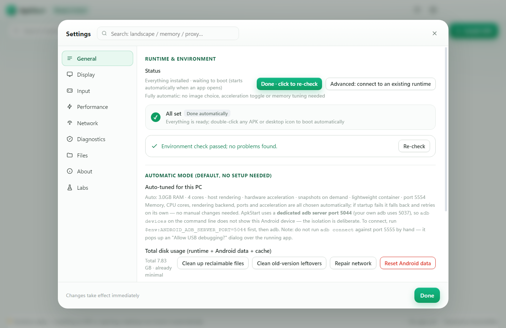
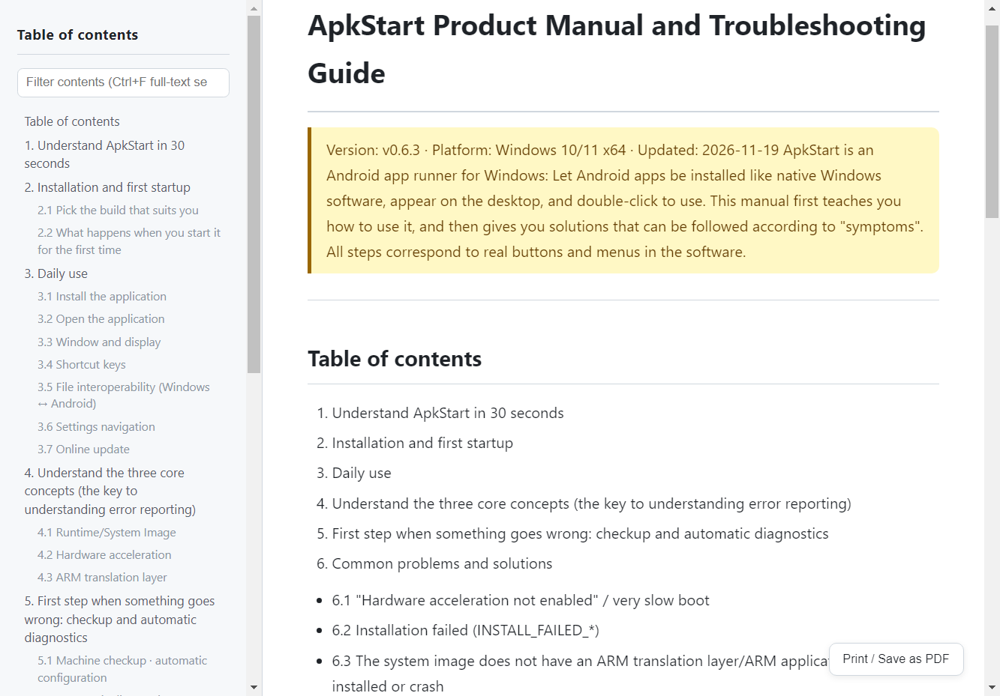

# ApkStart — English interface

Unofficial English translation for [ApkStart](https://github.com/RoutineMiku/apkstart) 0.6.3–0.6.4
(the Windows Android app runner published on the Microsoft Store as `RoutineMiku.ApkStart`).


Upstream ships Chinese only. This project adds an English layer at runtime and rewrites the
built-in manual. It supports both the Microsoft Store package and a local source checkout:

- **Store copy** — install into a separate folder, keep a desktop shortcut, and keep using it
  until upstream merges i18n (issue [#100](https://github.com/RoutineMiku/apkstart/issues/100),
  draft PR [#84](https://github.com/RoutineMiku/apkstart/pull/84)).
- **Source checkout** — patch a cloned `RoutineMiku/apkstart` repository in place and run it with
  `npm start`. Tested with upstream `0.6.4`.

## Requirements

- Windows 10/11 x64
- One of:
  - ApkStart **0.6.3 or 0.6.4** installed from the Microsoft Store, or
  - a local `RoutineMiku/apkstart` source checkout (tested on **0.6.4**; needs `src\main.js`
    and `package.json`)
- [Node.js](https://nodejs.org/) LTS 20+ (applies the patch; also runs a source checkout)
- Store copy only: ~2 GB free disk space for the copied Android runtime
- Store copy only: have the Store version closed while the English build runs — both share
  `%USERPROFILE%\ApkStart\data`

## Install

### Microsoft Store copy

```powershell
git clone https://github.com/Waleed2418/apkstart-english.git
cd apkstart-english
powershell -ExecutionPolicy Bypass -File .\install.ps1
```

The script:

1. locates the installed Store package,
2. copies the app to `%USERPROFILE%\ApkStartEN` (without the runtime),
3. applies the translation files and patches (`node patch/apply.js`),
4. copies the 1.68 GB Android runtime next to the app,
5. creates `ApkStart (English).lnk` on the desktop.

Options:

```powershell
# different folder
powershell -ExecutionPolicy Bypass -File .\install.ps1 -Target D:\ApkStartEN

# skip the 1.68 GB runtime copy (UI is English, Android apps cannot boot yet)
powershell -ExecutionPolicy Bypass -File .\install.ps1 -SkipRuntime

# no desktop shortcut
powershell -ExecutionPolicy Bypass -File .\install.ps1 -NoShortcut
```

Start **ApkStart (English)** and keep it. Do not start it while the Store version is open.

### Local source checkout

```powershell
git clone https://github.com/RoutineMiku/apkstart.git apkstart
git clone https://github.com/Waleed2418/apkstart-english.git apkstart-english
cd apkstart
npm install
powershell -ExecutionPolicy Bypass -File ..\apkstart-english\install.ps1 -LocalPath .
```

`-LocalPath` (alias: `-Source`) validates `src\main.js` and `package.json`, then runs
`node patch\apply.js <LocalPath>` directly against the checkout. In this mode the script:

- skips the Microsoft Store / `WindowsApps` / `ApkStart.exe` checks,
- skips the `resources\runtime` copy,
- applies the translation in place, without the Store-only `userData` and shared-data-directory
  patches, so the checkout keeps using `%APPDATA%\apkstart`,
- skips the desktop shortcut and prints the start command instead.

The patch modifies tracked files in the checkout. Commit or stash first if you want a clean diff.
Run the app from that folder:

```powershell
Remove-Item Env:ELECTRON_RUN_AS_NODE -ErrorAction SilentlyContinue
npm start
```

Removing `ELECTRON_RUN_AS_NODE` matters in IDE terminals, where it is often inherited from an
Electron-based editor; otherwise `npm start` runs Node instead of opening the app.

You can also apply the patch without the installer. `patch/apply.js` auto-detects the layout:

```powershell
# source checkout
node C:\path\to\apkstart-english\patch\apply.js C:\path\to\apkstart

# copied Store app
node C:\path\to\apkstart-english\patch\apply.js C:\Users\me\ApkStartEN
```

## Screenshots

| Settings | Manual |
| --- | --- |
|  |  |

`docs/screenshots/settings-about.png` shows the About tab.

## What gets changed

For Store mode, everything happens inside the copied folder (`resources\app`). For source mode,
the same paths are changed inside the checkout:

| Path | Change |
| --- | --- |
| `i18n\en-data.js` | English dictionary, 1840 entries, keyed by the Chinese source text |
| `i18n\en-merged.json` | Same dictionary for the main process |
| `i18n\i18n-core.js` | Matcher: exact, punctuation-normalized, templated `{placeholders}` |
| `i18n\i18n-dom.js` | Renderer overlay: text nodes, innerHTML blocks, attributes, `document.title`; MutationObserver + `textContent` setter for strings the app rewrites every second |
| `i18n\i18n-main.js` | Native dialogs, file filters, menus, tray tooltip, window titles |
| `src\ui\manual.html` | Statically translated manual (original saved as `manual.zh.html`) |
| `src\ui\index.html`, `shell.html`, `splash.html` | Load the overlay before the page script |
| `src\ui\app.js` | English deploy card, status text, relative times (these are built with `innerHTML`, so the overlay cannot catch them) |
| `src\core\doctor.js` | English auto-profile summary and DLL diagnosis title |
| `src\drivers\example-*.json` | English driver example names and notes |
| `src\main.js` | Loads `i18n-main`; **Store copy only:** uses `%APPDATA%\ApkStartEN` for Electron user data so it can coexist with the Store build |
| `src\core\store.js` | **Store copy only:** uses the shared `%USERPROFILE%\ApkStart\data` folder, so installed apps and settings carry over |

A local source checkout keeps its original `%APPDATA%\apkstart` data and runtime directories.
The Store package in `C:\Program Files\WindowsApps` is never written to.

### Why the runtime is copied, not linked

Store mode only. Linking `resources\runtime` to `WindowsApps` looks tempting, but Windows denies
executing the bundled `adb`/`qemu` binaries from there for a process without package identity.
The app then shows `Status check failed: ... spawn EPERM`. The runtime must be a real copy inside
the app folder. A source checkout downloads or uses its runtime under `%APPDATA%\apkstart` as
upstream intends.

## Updating

This translation targets 0.6.3–0.6.4. When ApkStart updates:

- Store copy: if the package changes version, re-run `install.ps1` into a fresh folder and check
  the output; `patch/apply.js` fails loudly when an anchor no longer matches.
- Source checkout: `git pull`, `npm install`, then re-run `install.ps1 -LocalPath` (or
  `node patch\apply.js`) and start with `npm start`.
- If upstream ships official language support, uninstall this copy and use the official build.

To remove the Store translation: delete `%USERPROFILE%\ApkStartEN`, the desktop shortcut, and
`%APPDATA%\ApkStartEN`. Shared data in `%USERPROFILE%\ApkStart\data` is left alone.

To revert a local source checkout, review `git status` and restore the tracked files the patch
changed (`git checkout -- src`), then delete the files it added (the `i18n` folder and
`src\ui\manual.zh.html`). `%APPDATA%\apkstart` is separate and is left alone.

## Known limitations

- Only the patched folder is English. The Store-installed copy stays Chinese.
- A source checkout is modified in place; keep a commit or stash if you need a clean tree.
- Text produced by the app after the overlay starts can flash Chinese for one frame
  (`innerHTML` writes); the patched `app.js` strings remove the visible cases.
- The built-in manual is machine-translated and then edited; wording may read dry.
- Three strings stay Chinese on purpose: the Japanese language option, `Douyin · 日常MIKU`,
  and the Douyin contact link.
- App names, APK contents and Android screens come from the apps themselves.

## Credits and license

- ApkStart © RoutineMiku — MIT, https://github.com/RoutineMiku/apkstart
- Dictionary based on PR #84 by Chomper9981 (`feat/i18n-en-vi`), reworked and extended here.
- This repository: MIT. See `LICENSE` and `NOTICE`.

Not affiliated with RoutineMiku. Report translation bugs here, not in the upstream issue
tracker, unless they are upstream i18n design issues.
