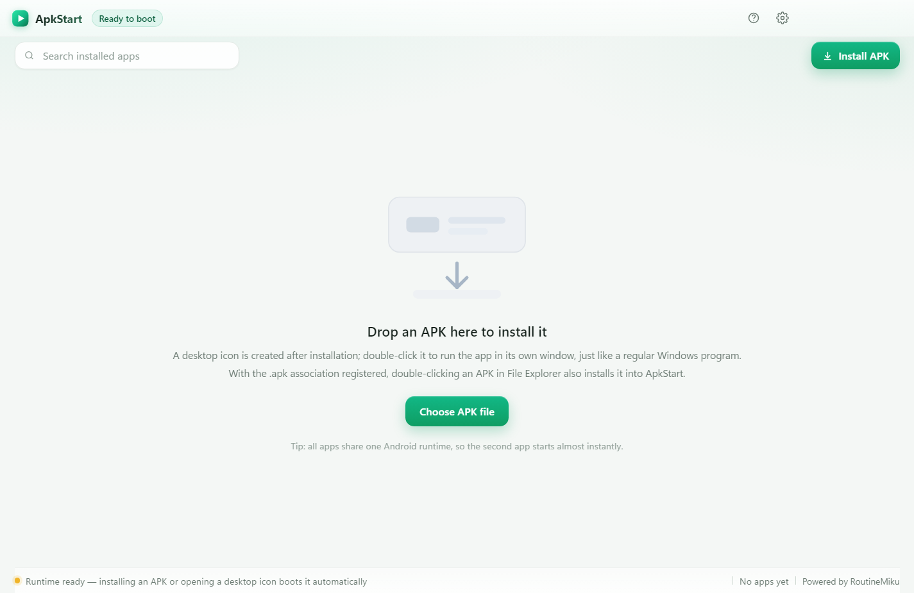

# ApkStart — English interface

Unofficial English translation for [ApkStart](https://github.com/RoutineMiku/apkstart) 0.6.3
(the Windows Android app runner published on the Microsoft Store as `RoutineMiku.ApkStart`).



Upstream ships Chinese only. This project adds an English layer at runtime and rewrites the
built-in manual, without touching the Store package. Install it into a separate folder, keep a
desktop shortcut, and switch to the official build once upstream merges i18n
(issue [#100](https://github.com/RoutineMiku/apkstart/issues/100), draft PR
[#84](https://github.com/RoutineMiku/apkstart/pull/84)).

## Requirements

- Windows 10/11 x64
- ApkStart 0.6.3 installed from the Microsoft Store (the script reads it from `WindowsApps`)
- [Node.js](https://nodejs.org/) LTS (only to apply the patch)
- ~2 GB free disk space for the copied Android runtime
- Have the Store version closed while the English build runs — both share
  `%USERPROFILE%\ApkStart\data`

## Install

```powershell
git clone https://github.com/Waleed2418/apkstart-english.git
cd apkstart-english
powershell -ExecutionPolicy Bypass -File .\install.ps1
```

The script:

1. locates the installed Store package,
2. copies the app to `%USERPROFILE%\ApkStartEN` (without the runtime),
3. applies the translation files and patches (`node patch/apply.js`),
4. copies the 1.68 GB Android runtime next to the app,
5. creates `ApkStart (English).lnk` on the desktop.

Options:

```powershell
# different folder
powershell -ExecutionPolicy Bypass -File .\install.ps1 -Target D:\ApkStartEN

# skip the 1.68 GB runtime copy (UI is English, Android apps cannot boot yet)
powershell -ExecutionPolicy Bypass -File .\install.ps1 -SkipRuntime

# no desktop shortcut
powershell -ExecutionPolicy Bypass -File .\install.ps1 -NoShortcut
```

Start **ApkStart (English)** and keep it. Do not start it while the Store version is open.

## Screenshots

| Settings | Manual |
| --- | --- |
|  |  |

`docs/screenshots/settings-about.png` shows the About tab.

## What gets changed

Everything happens inside the copied folder (`resources\app`):

| Path | Change |
| --- | --- |
| `i18n\en-data.js` | English dictionary, 1840 entries, keyed by the Chinese source text |
| `i18n\en-merged.json` | Same dictionary for the main process |
| `i18n\i18n-core.js` | Matcher: exact, punctuation-normalized, templated `{placeholders}` |
| `i18n\i18n-dom.js` | Renderer overlay: text nodes, innerHTML blocks, attributes, `document.title`; MutationObserver + `textContent` setter for strings the app rewrites every second |
| `i18n\i18n-main.js` | Native dialogs, file filters, menus, tray tooltip, window titles |
| `src\ui\manual.html` | Statically translated manual (original saved as `manual.zh.html`) |
| `src\ui\index.html`, `shell.html`, `splash.html` | Load the overlay before the page script |
| `src\ui\app.js` | English deploy card, status text, relative times (these are built with `innerHTML`, so the overlay cannot catch them) |
| `src\core\doctor.js` | English auto-profile summary and DLL diagnosis title |
| `src\drivers\example-*.json` | English driver example names and notes |
| `src\main.js` | Loads `i18n-main`; uses `%APPDATA%\ApkStartEN` for Electron user data so it can coexist with the Store build |
| `src\core\store.js` | Uses the shared `%USERPROFILE%\ApkStart\data` folder, so installed apps and settings carry over |

The Store package in `C:\Program Files\WindowsApps` is never written to.

### Why the runtime is copied, not linked

Linking `resources\runtime` to `WindowsApps` looks tempting, but Windows denies executing the
bundled `adb`/`qemu` binaries from there for a process without package identity. The app then
shows `Status check failed: ... spawn EPERM`. The runtime must be a real copy inside the app
folder.

## Updating

This translation targets 0.6.3. When ApkStart updates:

- if the Store package changes version, re-run `install.ps1` into a fresh folder and check the
  output; `patch/apply.js` fails loudly when an anchor no longer matches,
- if upstream ships official language support, uninstall this copy and use the official build.

To remove the translation: delete `%USERPROFILE%\ApkStartEN`, the desktop shortcut, and
`%APPDATA%\ApkStartEN`. Shared data in `%USERPROFILE%\ApkStart\data` is left alone.

## Known limitations

- Only this folder is English. The Store-installed copy stays Chinese.
- Text produced by the app after the overlay starts can flash Chinese for one frame
  (`innerHTML` writes); the patched `app.js` strings remove the visible cases.
- The built-in manual is machine-translated and then edited; wording may read dry.
- Three strings stay Chinese on purpose: the Japanese language option, `Douyin · 日常MIKU`,
  and the Douyin contact link.
- App names, APK contents and Android screens come from the apps themselves.

## Credits and license

- ApkStart © RoutineMiku — MIT, https://github.com/RoutineMiku/apkstart
- Dictionary based on PR #84 by Chomper9981 (`feat/i18n-en-vi`), reworked and extended here.
- This repository: MIT. See `LICENSE` and `NOTICE`.

Not affiliated with RoutineMiku. Report translation bugs here, not in the upstream issue
tracker, unless they are upstream i18n design issues.
